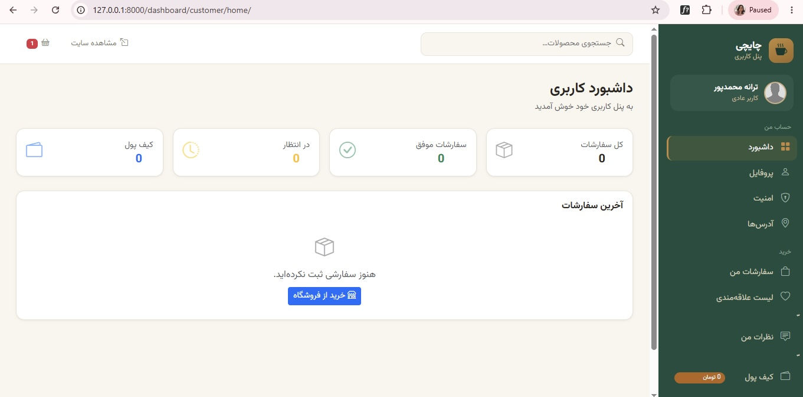
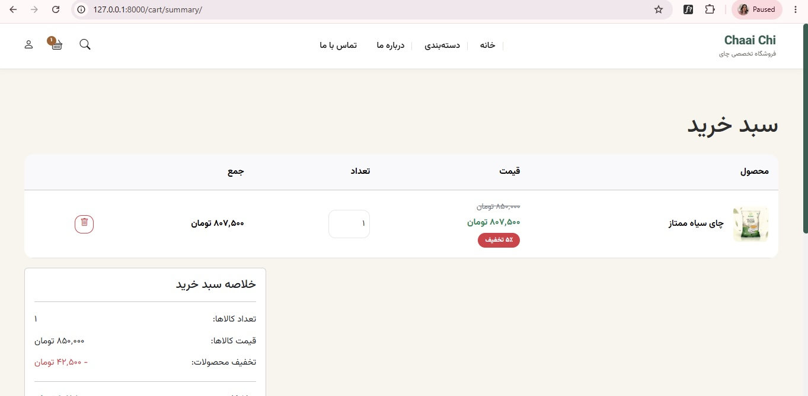

<div dir="rtl">

<h1 align="center">🍃 فروشگاه اینترنتی چایچی</h1>

<p align="center">
  <strong>فروشگاه آنلاین چای با Django: سبد خرید، پرداخت از کیف پول و زرین‌پال، سیستم نظرات و پنل‌های مدیریت</strong>
</p>

<p align="center">
  
  
  
  
</p>

---

## 📌 درباره پروژه

چایچی یک فروشگاه اینترنتی کامل برای فروش چای است که با Python و Django نوشته شده. این پروژه شامل کاتالوگ محصولات، سبد خرید، فرایند ثبت سفارش و پرداخت آنلاین است و برای مشتری و مدیر فروشگاه، هرکدام پنل جداگانه دارد.

---

## ✨ امکانات

### برای مشتری
- ثبت‌نام و ورود با Session، مدل کاربر سفارشی و آپلود آواتار
- نمایش محصولات با دسته‌بندی
- سبد خرید و ثبت سفارش
- پرداخت از **کیف پول** یا از طریق درگاه **زرین‌پال**
- ثبت نظر برای محصولات با سیستم تأیید نظر (به سبک دیجی‌کالا)
- داشبورد کاربری

### برای مدیر فروشگاه
- پنل Django Admin سفارشی‌شده برای مدیریت محصولات و سفارش‌ها
- داشبورد مدیریتی
- تأیید یا رد نظرات کاربران
- سطح دسترسی بر اساس نقش کاربر

### طراحی
- چیدمان **RTL** با Bootstrap 5 و فونت **وزیرمتن**
- سیستم طراحی با CSS Custom Properties (سبز جنگلی، طلایی، رس)
- پشتیبانی از اسلاگ فارسی
- طراحی ریسپانسیو

---

## 🧱 تکنولوژی‌ها

- Python و Django
- Bootstrap 5 (RTL)
- SQLite (محیط توسعه)
- درگاه پرداخت زرین‌پال

---

## 🚀 نصب و راه‌اندازی

### پیش‌نیازها

- Python 3.10 یا بالاتر
- pip

### مراحل نصب

```bash
git clone https://github.com/Taranemp/chaaichi-store.git
cd chaaichi-store
python -m venv .venv
```

فعال‌سازی محیط مجازی:

```bash
# ویندوز (Git Bash)
source .venv/Scripts/activate

# ویندوز (CMD / PowerShell)
.venv\Scripts\activate

# مک / لینوکس
source .venv/bin/activate
```

نصب پیش‌نیازها و راه‌اندازی دیتابیس:

```bash
pip install -r requirements.txt
python manage.py migrate
python manage.py createsuperuser
python manage.py runserver
```

سایت روی `http://127.0.0.1:8000/` و پنل مدیریت روی `http://127.0.0.1:8000/admin/` در دسترس است.

### متغیرهای محیطی

یک فایل `.env` در ریشه‌ی پروژه بساز و مقدارهای لازم مثل `SECRET_KEY` و `DEBUG` را داخلش بگذار. برای تست درگاه پرداخت، از Merchant ID حالت آزمایشی (Sandbox) زرین‌پال استفاده کن.

> ⚠️ فایل `.env` واقعی را هرگز commit نکن و کلیدهای درگاه پرداخت را در کد قرار نده.

---

## 🖼️ تصاویر

<p align="center">
  
  
  
</p>

---

## 🗺️ برنامه‌های آینده

- [ ] بازنویسی بخش پرداخت با معماری سرویس‌محور (`PaymentService`، `GatewayService`، `OrderService`، `WalletService`)
- [ ] REST API برای اتصال فرانت‌اند مجزا
- [ ] سیستم کوپن تخفیف
- [ ] خروجی فاکتور

---

## 👩‍💻 سازنده

**Taranemp**: [GitHub](https://github.com/Taranemp)

---

## 📄 مجوز

این پروژه فعلاً مجوز عمومی ندارد و تمام حقوق محفوظ است.

</div>