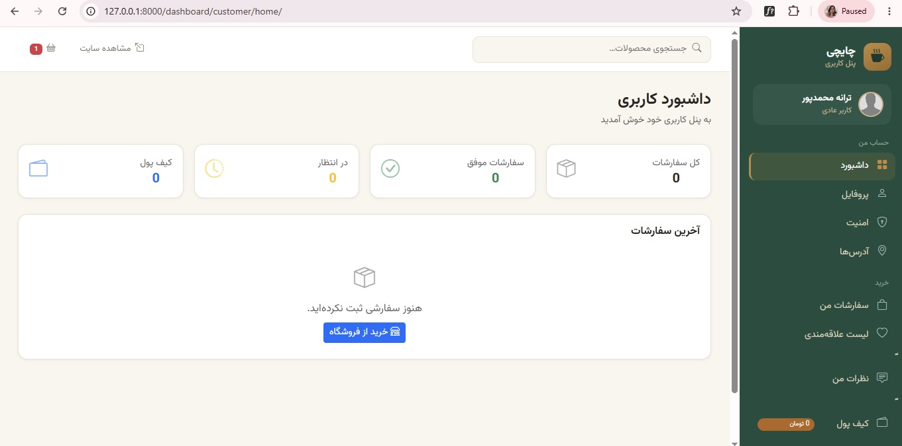
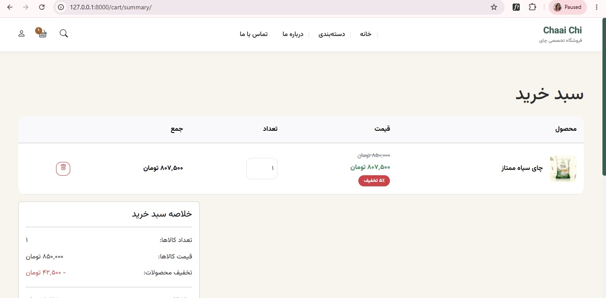

 <div dir="rtl">

# 🍃 فروشگاه اینترنتی چایچی

<p align="center">
  <strong>فروشگاه آنلاین چای با Django؛ شامل سبد خرید، پرداخت از کیف پول و زرین‌پال، سیستم نظرات و پنل‌های مدیریت</strong>
</p>

<p align="center">
  
  
  
  
  
  
</p>

---

## 📌 درباره پروژه

چایچی یک فروشگاه اینترنتی برای فروش چای است که با Python و Django توسعه داده شده است.

این پروژه شامل کاتالوگ محصولات، دسته‌بندی، سبد خرید، ثبت سفارش و پرداخت آنلاین است. همچنین برای مشتریان و مدیر فروشگاه، امکانات و پنل‌های مدیریتی جداگانه در نظر گرفته شده است.

پروژه از تنظیمات مستقل برای محیط توسعه و Production استفاده می‌کند و برای مدیریت دیتابیس در محیط‌های مختلف، از SQLite و PostgreSQL بهره می‌برد.

---

## ✨ امکانات

### برای مشتری

- ثبت‌نام و ورود با Session، مدل کاربر سفارشی و آپلود آواتار
- نمایش محصولات همراه با دسته‌بندی
- سبد خرید و ثبت سفارش
- پرداخت از طریق **کیف پول** یا درگاه **زرین‌پال**
- ثبت نظر برای محصولات با سیستم تأیید نظر
- داشبورد کاربری

### برای مدیر فروشگاه

- پنل Django Admin سفارشی‌شده برای مدیریت محصولات و سفارش‌ها
- داشبورد مدیریتی
- تأیید یا رد نظرات کاربران
- سطح دسترسی بر اساس نقش کاربر

### طراحی

- چیدمان **RTL** با Bootstrap 5 و فونت وزیرمتن
- سیستم طراحی با CSS Custom Properties
- پشتیبانی از اسلاگ فارسی
- طراحی ریسپانسیو

---

## 🧱 تکنولوژی‌ها

- Python
- Django 5.2
- Bootstrap 5 RTL
- SQLite برای محیط توسعه
- PostgreSQL برای محیط‌های Preview و Production
- Neon برای میزبانی دیتابیس PostgreSQL
- `psycopg` برای اتصال Django به PostgreSQL
- `dj-database-url` برای مدیریت آدرس اتصال دیتابیس
- زرین‌پال برای پرداخت آنلاین
- Vercel برای استقرار پروژه

---

## ⚙️ معماری تنظیمات و دیتابیس

پروژه از تنظیمات جداگانه برای محیط‌های مختلف استفاده می‌کند:

| محیط | تنظیمات Django | دیتابیس |
|---|---|---|
| Development | `core.settings.development` | SQLite |
| Preview | `core.settings.production` | Neon PostgreSQL – `preview` branch |
| Production | `core.settings.production` | Neon PostgreSQL – `production` branch |

### Development

در محیط توسعه، پروژه به‌صورت محلی اجرا می‌شود و از SQLite استفاده می‌کند.

تنظیمات توسعه در فایل زیر قرار دارد:

`core/settings/development.py`

### Preview و Production

در محیط‌های استقرار، پروژه از PostgreSQL استفاده می‌کند.

تنظیمات Production در فایل زیر قرار دارد:

`core/settings/production.py`

اتصال به دیتابیس از طریق متغیر محیطی `DATABASE_URL` انجام می‌شود.

برای مدیریت اتصال به PostgreSQL از `dj-database-url` و `psycopg` استفاده شده است.

**نکته:** دیتابیس‌های Preview و Production در Neon از یکدیگر جدا هستند تا آزمایش تغییرات روی داده‌های اصلی فروشگاه تأثیر نگذارد.

---

## 🚀 نصب و راه‌اندازی محلی

### پیش‌نیازها

- Python 3.10 یا بالاتر
- pip
- Git

### ۱. دریافت پروژه

```bash
git clone https://github.com/Taranemp/chaaichi-store.git
cd chaaichi-store
```

### ۲. ساخت محیط مجازی

```bash
python -m venv .venv
```

فعال‌سازی محیط مجازی:

```bash
# Windows - Git Bash
source .venv/Scripts/activate

# Windows - CMD / PowerShell
.venv\Scripts\activate

# macOS / Linux
source .venv/bin/activate
```

### ۳. نصب وابستگی‌ها

```bash
pip install -r requirements.txt
```

### ۴. تنظیم متغیرهای محیطی

برای محیط توسعه، فایل `.development.env` را در ریشه پروژه ایجاد کنید.

این فایل باید شامل متغیرهایی باشد که تنظیمات توسعه پروژه از آن‌ها استفاده می‌کند. فایل‌های محیطی واقعی نباید در Git ثبت شوند.

### ۵. اجرای Migrationها

```bash
python manage.py migrate
```

### ۶. ساخت حساب مدیر

```bash
python manage.py createsuperuser
```

### ۷. اجرای سرور توسعه

```bash
python manage.py runserver
```

سایت در آدرس زیر در دسترس خواهد بود:

`http://127.0.0.1:8000/`

پنل مدیریت:

`http://127.0.0.1:8000/admin/`

---

## ☁️ استقرار روی Vercel

پروژه برای استفاده از تنظیمات Production در محیط‌های استقرار آماده شده است.

برای اتصال پروژه به دیتابیس PostgreSQL از سرویس **Neon** استفاده می‌شود.

### متغیرهای محیطی موردنیاز

متغیرهای زیر باید در بخش Environment Variables پروژه در Vercel تنظیم شوند:

| متغیر | توضیحات |
|---|---|
| `SECRET_KEY` | کلید محرمانه Django |
| `DEBUG` | در Production باید غیرفعال باشد |
| `DJANGO_SETTINGS_MODULE` | مقدار `core.settings.production` |
| `ALLOWED_HOSTS` | دامنه‌های مجاز پروژه |
| `CSRF_TRUSTED_ORIGINS` | آدرس‌های مجاز برای درخواست‌های CSRF |
| `DATABASE_URL` | آدرس اتصال PostgreSQL در Neon |

### تنظیم محیط‌ها

- **Preview:** متصل به شاخه `develop` در GitHub و شاخه `preview` در Neon
- **Production:** متصل به شاخه `main` در GitHub و شاخه `production` در Neon

هر محیط باید `SECRET_KEY` و `DATABASE_URL` مخصوص به خودش را داشته باشد.

### اجرای Migration در دیتابیس Production

پس از تنظیم اتصال دیتابیس، Migrationهای Django باید روی دیتابیس مربوط به هر محیط اجرا شوند:

```bash
python manage.py migrate --settings=core.settings.production
```

**نکات امنیتی:**

- هیچ‌وقت `SECRET_KEY` یا `DATABASE_URL` را در کد یا GitHub قرار ندهید.
- فایل‌های `.env` و فایل‌های محیطی واقعی باید در `.gitignore` باشند.
- برای محیط Preview و Production از دیتابیس و کلیدهای جداگانه استفاده کنید.
- از SQLite برای نگهداری داده‌های دائمی در محیط Serverless استفاده نکنید.

---

## 🖼️ تصاویر پروژه

<p align="center">
  
  
  
</p>

---

## 🗺️ برنامه‌های آینده

- [ ] بازنویسی بخش پرداخت با معماری سرویس‌محور (`PaymentService`، `GatewayService`، `OrderService` و `WalletService`)
- [ ] REST API برای اتصال فرانت‌اند مجزا
- [ ] سیستم کوپن تخفیف
- [ ] خروجی فاکتور

---

## 👩‍💻 سازنده

**Taranemp**

[GitHub Profile](https://github.com/Taranemp)

---

## 📄 مجوز

این پروژه فعلاً مجوز عمومی ندارد و تمام حقوق آن محفوظ است.

</div>